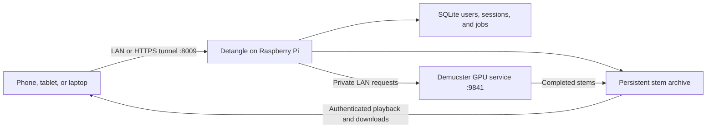

<div align="center">

# Detangle

### hear the layers

A private, multi-user web workspace for turning music into isolated stems with Demucster.

</div>

Detangle is a responsive web application for uploading local audio or submitting a
supported URL, choosing a Demucs model, following separation progress, listening
to individual stems, and downloading the result. It adds authentication,
per-user workspaces, administration, and durable retention around a private
Demucster GPU service.

The application is designed to run as one small Docker container on a Raspberry
Pi. Separation still runs on the Demucster host at `192.168.50.93:9841`; the Pi
handles the web interface, accounts, metadata, and retained stem files.

## Features

- Private sign-in with no public registration
- Administrator-created accounts and cryptographically generated passwords
- Per-user workspaces with strict ownership checks
- Admin access to users, sessions, jobs, archives, storage, and retention
- Uploads for MP3, WAV, FLAC, OGG, and M4A
- URL submissions supported by the upstream Demucster downloader
- Downloaded song titles with editable workspace names and clickable source URLs
- Optional retention of the complete URL-sourced song alongside its stems
- All Demucster models with descriptions, stem lists, and quality/speed guidance
- MP3 or WAV output and selectable MP3 bitrate
- Select all stems or only the layers you need
- Live queue, processing, archiving, and failure progress
- Authenticated in-browser stem playback
- Individual stem and all-stems ZIP downloads
- Durable local archive independent of Demucster's 24-hour cleanup
- Configurable retention, defaulting to 30 days
- Live GPU, queue, and Raspberry Pi storage health
- Dark, responsive interface for phones, tablets, and laptops

## Architecture



The browser only communicates with Detangle. It never sees or calls the private
Demucster address. Detangle forwards new submissions, polls the job, copies each
finished stem into its own persistent volume with an atomic write, verifies the
archive, and normally deletes the redundant Demucster job.

This matters because Demucster currently stores job metadata in memory and
cleans files after 24 hours. A completed Detangle archive survives Demucster
restarts and remains available until Detangle's retention period expires.

## Requirements

- A 64-bit Raspberry Pi operating system
- Docker Engine with the Compose plugin
- Network access from the Pi to the Demucster host
- Enough Pi storage for all stems retained during the configured period
- Demucster reachable at `http://192.168.50.93:9841`, or another URL supplied
  through configuration
- A Demucster build that includes `GET /api/v1/jobs/{job_id}/source` when users
  select the optional complete original mix

The container is multi-architecture and does not perform audio separation. It
does not require CUDA, ffmpeg, Node.js, or Python on the Raspberry Pi host.

## Raspberry Pi deployment

### 1. Install Docker

Install Docker using the current instructions for your Raspberry Pi
distribution. Ensure both commands work:

```bash
docker --version
docker compose version
```

Enable Docker at boot:

```bash
sudo systemctl enable --now docker
```

Optionally allow your normal account to manage Docker without `sudo`:

```bash
sudo usermod -aG docker "$USER"
```

Sign out and back in after changing group membership.

### 2. Copy the project to the Pi

Clone it from its Git remote:

```bash
git clone https://github.com/AsimAryal/detangle.git
cd detangle
```

You can also copy the project directory to the Pi with your preferred file
transfer tool.

### 3. Verify the private API

Run this on the Raspberry Pi:

```bash
curl -fsS http://192.168.50.93:9841/api/v1/health
curl -fsS http://192.168.50.93:9841/api/v1/models
```

Do not continue until both requests succeed. If Demucster uses a different
address, use it in the next step.

### 4. Configure Detangle

Create the private environment file:

```bash
cp .env.example .env
chmod 600 .env
```

Generate a strong initial password:

```bash
openssl rand -base64 24
```

Edit `.env` and set at least:

```dotenv
DEMUCSTER_URL=http://192.168.50.93:9841
INITIAL_ADMIN_USERNAME=admin
INITIAL_ADMIN_PASSWORD=replace-with-the-generated-password
INITIAL_ADMIN_DISPLAY_NAME=Administrator
COOKIE_SECURE=false
```

The initial administrator values are only used when the database has no users.
Changing `INITIAL_ADMIN_PASSWORD` later does not reset the existing account.
Use the Profile page or the administration panel to change passwords after
first boot.

### 5. Build and start

```bash
docker compose up -d --build
docker compose ps
docker compose logs -f detangle
```

When the health check reports `healthy`, open:

```text
http://<raspberry-pi-address>:8009
```

Sign in with the initial administrator credentials. The container uses
`restart: unless-stopped`, so it starts automatically whenever Docker starts.
A separate systemd unit for Detangle is not required.

## First-time setup

After signing in:

1. Open Admin, then Users.
2. Create an account with a username, display name, and role.
3. Let Detangle generate a password or enter one manually.
4. Copy the generated password from the one-time credentials dialog.
5. Give the credentials to the user through a private channel.

Users are not forced to change their password. On their first sign-in only,
Detangle shows a toast pointing to the password control in Profile.

Administrators can:

- Create and remove users
- Generate or reset passwords
- Enable, disable, promote, or demote accounts
- Revoke sessions immediately
- Inspect login and storage activity
- Open every user's workspace
- Download or delete any job
- Retry an interrupted archive
- Change the global retention period
- Choose whether verified remote jobs are deleted after archiving

The final active administrator cannot be disabled, demoted, or deleted.

## Job and archive lifecycle

1. The user submits a file or URL to Detangle.
2. Detangle validates the request and forwards it to Demucster.
3. Demucster queues and processes the audio.
4. Detangle polls the private job endpoint and displays progress.
5. On completion, Detangle downloads every returned stem and, when selected,
   the complete URL-sourced mix into temporary `.part` files in its persistent
   volume.
6. Each completed transfer is atomically renamed and recorded in SQLite.
7. When every stem is verified, the job becomes Ready and receives an
   expiration date.
8. Detangle deletes the redundant remote job when that setting is enabled.
9. The retention sweeper removes the database record and local files after the
   configured period.

If Detangle restarts while copying files, it resumes unfinished work. If
Demucster restarts before a job is archived, its in-memory job record can be
lost; Detangle marks that job unavailable and explains the condition.

## Storage planning

MP3 stems are much smaller than WAV stems. WAV output can require several times
the size of the source because each separated layer is a full-length,
uncompressed audio file. Six-stem WAV jobs should be treated as potentially
large.

The dashboard shows archive use and free space. Size the Pi's disk for:

```text
average output size × jobs per day × retention days
```

The default named volume is `detangle-data`. Inspect it with:

```bash
docker volume inspect detangle-data
```

Reduce retention or remove old jobs from the admin workspace before the disk
becomes full. Archiving failures caused by low space remain visible and can be
retried after space is recovered.

## Backups

The persistent volume contains both the SQLite database and archived stems.
For a consistent offline backup:

```bash
docker compose stop detangle
mkdir -p backups
docker run --rm \
  -v detangle-data:/source:ro \
  -v "$PWD/backups:/backup" \
  alpine sh -c 'cd /source && tar czf /backup/detangle-$(date +%Y%m%d-%H%M%S).tar.gz .'
docker compose start detangle
```

Copy the resulting archive away from the Raspberry Pi.

To restore into an empty volume:

```bash
docker compose down
docker volume rm detangle-data
docker volume create detangle-data
docker run --rm \
  -v detangle-data:/target \
  -v "$PWD/backups:/backup:ro" \
  alpine sh -c 'cd /target && tar xzf /backup/YOUR-BACKUP.tar.gz'
docker compose up -d
```

Restoring replaces current users, sessions, settings, jobs, and stem files with
the backup state.

## HTTPS tunnels and reverse proxies

Detangle is intentionally exposed as plain HTTP on port `8009` inside the LAN.
Terminate TLS at your tunnel or reverse proxy.

Before exposing it beyond the LAN:

1. Point the tunnel origin at `http://127.0.0.1:8009` or the Pi's LAN address.
2. Ensure the proxy sends `X-Forwarded-Proto: https` and preserves the original
   host.
3. Set `COOKIE_SECURE=true`.
4. Replace `TRUSTED_HOSTS=*` with a comma-separated list containing the tunnel
   hostname and any LAN hostname you still use.
5. Recreate the container with `docker compose up -d`.

Do not expose port `9841` through the tunnel. Demucster has no authentication.
Only Detangle should be publicly reachable.

When `COOKIE_SECURE=true`, browsers will not send the session cookie over plain
HTTP. If you still need direct LAN access, use HTTPS on the LAN as well or
temporarily set it to false while the tunnel is not in use.

## Configuration reference

All settings are read from `.env`.

### Upstream service

- `DEMUCSTER_URL`: private Demucster base URL
- `MAX_UPLOAD_MB`: upload limit enforced by Detangle; keep it at or below
  Demucster's `MAX_FILE_SIZE_MB`
- `POLL_INTERVAL_SECONDS`: active job synchronization interval
- `ARCHIVE_CONCURRENCY`: maximum simultaneous stem archive operations

### Accounts and sessions

- `INITIAL_ADMIN_USERNAME`: username created only for an empty database
- `INITIAL_ADMIN_PASSWORD`: initial administrator password
- `INITIAL_ADMIN_DISPLAY_NAME`: initial display name
- `SESSION_COOKIE_NAME`: opaque browser cookie name
- `SESSION_DAYS`: session lifetime
- `COOKIE_SECURE`: require HTTPS when sending the session cookie
- `TRUSTED_HOSTS`: accepted Host headers, separated by commas

### Data and retention

- `DATABASE_URL`: async SQLAlchemy URL; the Compose default points into `/data`
- `DATA_DIR`: root for the database-adjacent archive and temporary ZIPs
- `DEFAULT_RETENTION_DAYS`: initial global retention setting
- `DELETE_REMOTE_AFTER_ARCHIVE`: remove the Demucster copy after verification
- `RETENTION_SWEEP_MINUTES`: cleanup interval

Retention and remote-deletion settings can subsequently be changed from the
admin interface and are persisted in SQLite.

### Application

- `LOG_LEVEL`: Python logging level
- `FRONTEND_DIR`: built SPA directory; the container sets `/app/frontend`

## Updates and rollback

Create a backup before every update. Then:

```bash
git pull --ff-only
docker compose build --pull
docker compose up -d
docker compose logs -f detangle
```

Database migrations run during startup and are designed to preserve existing
data.

For rollback, check out the previous known-good Git revision, rebuild, and
restore the pre-upgrade backup if that version cannot read the migrated
database.

## Operations

Check container status:

```bash
docker compose ps
```

Follow logs:

```bash
docker compose logs -f --tail=200 detangle
```

Restart the app:

```bash
docker compose restart detangle
```

Verify local liveness:

```bash
curl -fsS http://127.0.0.1:8009/api/healthz
```

Detangle's liveness check intentionally does not fail when Demucster is offline.
The dashboard reports upstream health separately, avoiding a restart loop while
the GPU host is unavailable.

## Troubleshooting

### The container is unhealthy

Inspect logs with `docker compose logs detangle`. Common causes are an invalid
environment value, an unreadable data volume, or a failed database migration.

### Sign-in succeeds but immediately returns to the login page

If you use plain HTTP, set `COOKIE_SECURE=false`. If you use a tunnel with
HTTPS, set it to true and confirm `X-Forwarded-Proto` is forwarded.

### The host is rejected

Add the exact LAN or tunnel hostname to `TRUSTED_HOSTS`, or use `*` temporarily
while diagnosing the first deployment.

### Demucster is shown as offline

Run the health `curl` command from the Raspberry Pi. Confirm routing, firewall
rules, the configured port, and that Demucster listens on the LAN interface.

### A job became unavailable

Demucster's job registry is in memory. A Demucster restart before Detangle
finishes its archive removes the lookup needed to recover that job. Submit the
source again. Jobs already marked Ready are unaffected.

### An archive is retrying

Check free Pi storage and connectivity to Demucster. Administrators can retry
the archive from the job controls after resolving the problem.

### Upload fails with 413

Ensure `MAX_UPLOAD_MB` is not higher than Demucster's configured upload limit.
Large uploads also need enough temporary space available to the web process.

## Local development

### Backend

```bash
cd backend
python -m venv .venv
source .venv/bin/activate
pip install -e ".[dev]"
```

On PowerShell, activate with:

```powershell
.\.venv\Scripts\Activate.ps1
```

Use development settings that write into the repository:

```dotenv
DATABASE_URL=sqlite+aiosqlite:///./detangle-dev.db
DATA_DIR=./data
DEMUCSTER_URL=http://192.168.50.93:9841
INITIAL_ADMIN_USERNAME=admin
INITIAL_ADMIN_PASSWORD=Development-Password1!
COOKIE_SECURE=false
FRONTEND_DIR=../frontend/dist
```

Start the API:

```bash
uvicorn app.main:app --reload --port 8000
```

Run checks:

```bash
ruff check .
pytest
```

### Frontend

```bash
cd frontend
npm ci
npm run dev
```

The development server proxies `/api` to FastAPI. Other checks:

```bash
npm run lint
npm run test
npm run build
```

### Full production build

From the repository root:

```bash
docker compose build
docker compose config
```

The frontend is compiled in the first image stage. The final image contains
only the FastAPI runtime and static assets.

## Security notes

- Demucster has no authentication and must remain on the trusted LAN.
- Passwords are hashed with Argon2; generated plaintext passwords are returned
  once and never stored.
- Session cookies are opaque, HttpOnly, SameSite, and stored as hashes in the
  database.
- Every job and file lookup applies an owner or administrator check.
- Unsafe cookie-authenticated requests enforce same-origin checks.
- Public registration is intentionally absent.
- Disabling an account revokes its sessions.
- The container runs as an unprivileged user with Linux capabilities removed
  and a read-only root filesystem.

## License

No license has been selected for this repository. Add one before distributing
the project outside its intended private deployment.

